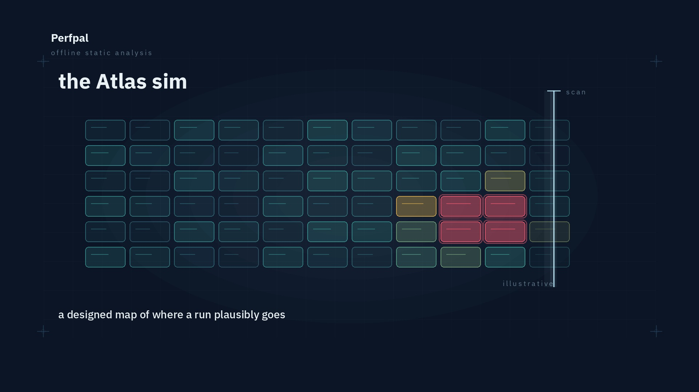
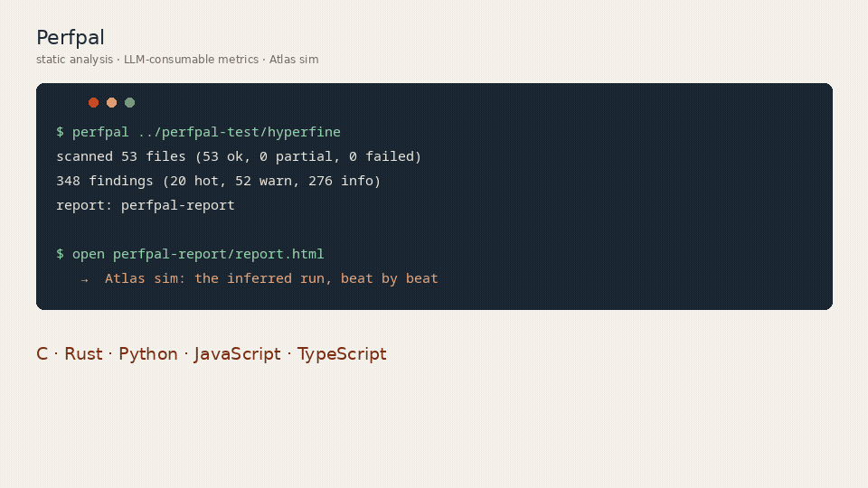

# Perfpal

**Static analysis for the age of AI-generated code — one offline scan, a designed bottleneck map, and metrics an LLM can actually reason about.**

[](https://github.com/ibraramin/perfpal/actions/workflows/ci.yml)
[](https://github.com/ibraramin/perfpal/actions/workflows/release.yml)
[](LICENSE)
[](rust-toolchain.toml)

> **Pre-release `0.5.1`** · metrics schema `1.9` · noncommercial evaluation only. See [License & legal](#license--legal).

### Launch film

[](docs/assets/brag.mp4)

https://github.com/user-attachments/assets/f72482c1-a9a0-490e-95a8-d92a9ff541f4

_An abstract radiograph of a codebase: one offline scan becomes a designed bottleneck map and a
versioned metrics file. The heat map is illustrative; no runtime numbers are plotted._


### See it work



A scan of the `hyperfine` source tree: the CLI reports 53 files and 348 optimization candidates, then the self-contained **Atlas sim** replays the inferred run — entry → stages → loops → I/O → stop — entirely offline, from the generated report.

---

## Why Perfpal

AI-generated codebases are large, often non-compiling, and frequently missing headers or build configuration — exactly where a compiler-based performance pipeline stops working. Perfpal uses bundled tree-sitter grammars, so it needs **no build flags, no compile database, no macro expansion, and no network access**.

Three complementary outputs come from the same deterministic scan:

| Output | What it gives you |
|---|---|
| **Atlas sim** (`report.html`) | A self-contained, scrubbable visual of where a run plausibly goes, which files are hot, and what breaks if you touch them — the "where do I look first?" answer. |
| **Quantified metrics** (`metrics.json`) | A versioned, LLM-consumable document: 78 rule findings, call/include graphs, component ranks, per-function cost, parse health, and explicit confidence/severity on every finding. |
| **Human + agent reports** (`report.md`, `agent-report.md`, `agent-actions.json`) | Bounded, ranked actions for people and coding agents, plus complete drill-down pages for the cases that need depth. |

Every finding is framed as an **optimization candidate to confirm with a profiler**, never a certainty. Static analysis is approximate by design; Perfpal makes the hypothesis explicit and quantified instead of asking an LLM to guess.

## Install

Perfpal is not on crates.io (`publish = false`); it ships as release assets from [`ibraramin/perfpal`](https://github.com/ibraramin/perfpal). Each v0.5.1 release carries **18 assets**:

- **six target binaries** (table below) + six per-file `.sha256` checksums;
- **`SHA256SUMS`** — one aggregate checksum manifest over the six binaries;
- **`perfpal-<version>.spdx.json`** — SPDX 2.3 SBOM of the dependency closure;
- **`THIRD-PARTY-NOTICES.md`** — attribution for bundled third-party crates;
- **`EULA.md`**, **`PRIVACY.md`**, **`LICENSE`** — the evaluation terms, no-telemetry statement, and license.

| Asset | Platform |
|---|---|
| `perfpal-x86_64-unknown-linux-musl` + `.sha256` | Linux x86-64, statically linked (musl) |
| `perfpal-aarch64-unknown-linux-musl` + `.sha256` | Linux arm64, statically linked (musl) |
| `perfpal-x86_64-unknown-linux-gnu` + `.sha256` | Linux x86-64, glibc (semantic-tier vehicle) |
| `perfpal-x86_64-apple-darwin` + `.sha256` | macOS x86-64 |
| `perfpal-aarch64-apple-darwin` + `.sha256` | macOS arm64 (Apple Silicon) |
| `perfpal-x86_64-pc-windows-msvc.exe` + `.sha256` | Windows x86-64 (MSVC) |

Example install and checksum verification (the `.sha256` embeds the shipped filename, so `sha256sum -c` works as-is):

```bash
gh release download v0.5.1 --repo ibraramin/perfpal --pattern 'perfpal-x86_64-unknown-linux-musl*'
chmod +x perfpal-x86_64-unknown-linux-musl
sha256sum -c perfpal-x86_64-unknown-linux-musl.sha256
```

For the aggregate manifest, download `SHA256SUMS` alongside the binaries and run `sha256sum -c SHA256SUMS`. The manifest is **checksum-only at v0.5.1** — there is no minisign signature in this release. The gnu, darwin and Windows builds include the default-OFF `semantic-clang` feature and use libclang when it is installed (`LIBCLANG_PATH`); without it they degrade gracefully to the syntactic tier. The musl builds stay syntactic-only by design.

From source (toolchain pinned to Rust 1.92.0 in `rust-toolchain.toml`):

```bash
cargo build --release --locked
```

## Quickstart

```console
$ perfpal path/to/your-project
scanned 214 files (210 ok, 3 partial, 1 failed) · 57 findings (3 hot, 21 warn, 33 info)
report: perfpal-report
```

The summary line is illustrative, not a stability contract. Use `-o` to relocate the report:

```bash
perfpal . -o my-report
```

A completed scan leaves exactly this layout (default `perfpal-report/`):

```
perfpal-report/
├── metrics.json              # raw machine-readable data (schema v1.9)
├── metrics.schema.v1.9.json  # byte-copy of the exact schema for this schema_version
├── report.html               # the Atlas sim — main human page, self-contained and offline
├── report.md                 # human-readable report (answer-first key views)
├── findings-detail.html      # complete ranked action list + full finding detail
├── profile-queue.md          # complete cost-ranked function list (KV3 drill)
├── profile-queue.html        # same list as an HTML table
├── atlas-weight.html         # Atlas weight drill (complete file/component share detail)
├── atlas-q2.html             # Atlas blast-radius drill (dependents + component DSM)
├── agent-report.md           # bounded LLM-facing triage report
├── agent-actions.json        # complete machine action list
└── charts/                   # deterministic SVG visualizations (set defined by ADR-0002)
    └── <chart-name>.svg
```

**`report.html` is the Atlas sim, and only the Atlas sim** (v0.5.1): a warm-paper shell, one line of scan context, links to the other artifacts, and the fixed player. The player replays the inferred run from an inline `application/json` payload — no `fetch`, no `eval`, no HTTP, fully offline from `file://` — with a `<noscript>` narrative when JavaScript is off. It is static inference, never a runtime trace. The full map, charts, Explorer and Findings composition remains available in the library through `render_html_with_story_at_width`.

Tooling and LLM sessions should start at `metrics.json` (validate against the bundled schema copy) or `agent-report.md` / `agent-actions.json`; humans start at `report.html`. Never parse data out of the SVGs — they are advisory.

## CLI reference

| Flag | Argument | Default | Meaning |
|---|---|---|---|
| `<path>` (positional) | `PATH` | `.` | Directory or single `.c`/`.h`/`.rs`/`.py`/`.pyi`/`.js`/`.jsx`/`.mjs`/`.cjs`/`.ts`/`.mts`/`.cts`/`.tsx` file (declaration-only `.d.*` skipped) |
| `-o`, `--output` | `DIR` | `perfpal-report` | Report directory; internal layout is fixed (output-contract §2) |
| `--force` | — | off | Replace an existing directory that contains no `metrics.json` (safety-guard override) |
| `--story` | — | off | Also emit `atlas-layout.json`, the opt-in geometry/flow payload for the standalone Atlas sim companion; changes no shared artifact |
| `--report-width` | `auto\|1280\|1440\|1920\|2560\|3072` | `auto` | Layout-only width hint for `report.html`; never changes data or scripts |
| `--version` | — | — | Print `perfpal <version> (metrics schema <schema_version>)`, exit 0 |
| `-h`, `--help` | — | — | Usage text, exit 0; prints the beta evaluation-notice footer |

stdout carries the short summary above; every diagnostic goes to stderr with no color or cursor control, so output stays pipe-clean. Machine consumption starts at `metrics.json`, never stdout parsing.

## Exit codes

| Code | Meaning |
|---|---|
| `0` | Success — report written. Findings never affect the exit code; a zero-file scan succeeds with a valid empty report (`scan.languages` = `["c","js","python","rust","ts","tsx"]`). |
| `1` | Usage error — unknown flag; missing/unreadable target path. |
| `2` | Output error — cannot create output dir; safety-guard refusal without `--force`; disk/write failure. |
| `3` | Internal error — unexpected panic/crash (also covers a `metrics.json` serialization failure). |

## How it works

1. **Scan** — recursive discovery in lexicographic order (dot-directories skipped, symlinks not followed); skips dependency/build directories, minified bundles and files over 2 MiB. Five tree-sitter backends parse C, Rust, Python, JavaScript and TypeScript/TSX; declaration-only `.d.ts`/`.d.mts`/`.d.cts` files are skipped. Parse health (ok/partial/failed) is captured per file.
2. **Analyze** — 78 catalog heuristics run as pure functions over a parser-agnostic IR. Every finding carries mandatory `confidence` and `severity`; documented downgrade hooks cap confidence instead of silently trusting uncertain data.
3. **Aggregate** — include graph, name-based cross-file call graph, component ranking and per-function statistics become one `metrics.json` with every sort order explicitly owned.
4. **Render** — the sim, reports and SVG charts are pure functions of `metrics.json`, from fixed templates.
5. **Write** — the report directory is built in a temporary sibling and swapped into place atomically; an interrupted run never leaves a half-written report.

## Heuristics

Perfpal's catalog defines **78** heuristics — 23 C (`PERF-C-*`), 22 Rust (`PERF-RS-*`), 22 Python (`PERF-PY-*`) and 11 shared JavaScript/TypeScript (`PERF-JS-*`). Every finding has `confidence` (HIGH/MEDIUM/LOW) and `severity` (`hot`/`warn`/`info`); both are prioritization hints. The tables show catalog defaults; documented hooks shift severity and cap confidence. Rust, Python and JS/TS are syntactic-tier only; the optional C semantic tier upgrades resolved cross-file edges on builds with libclang present.

### C (`PERF-C-*`) — 23 rules

| Family | Rules |
|---|---|
| ALLOC | `001` alloc in loop (hot/HIGH) · `002` free in loop (warn/HIGH) · `003` additive `realloc` growth (hot/MEDIUM) |
| ARCH | `001` include fan-out/cycles (warn/HIGH) · `002` hot-component aggregation (hot/HIGH) · `003` name-based cross-file calls (info/LOW) |
| CALL | `001` direct recursion (info/HIGH) · `002` cyclomatic complexity ≥ 15 (warn/HIGH) |
| LOOP | `001` nesting ≥ 3 · `002` I/O/setup in loop (hot/MEDIUM) · `003` char-wise stdio · `004` variable divisor · `005` global store · `006` indirect call · `007` linear scan · `008` pointer chain |
| MEM | `001` `sizeof` misuse · `002` block copy with variable size |
| STR | `001` `strcat` accumulation (hot/HIGH) · `002` `strlen` in loop (warn/HIGH) · `003` unbounded copy family (warn/HIGH) |
| TYPE | `001` large struct by value · `002` padding waste |

### Rust (`PERF-RS-*`) — 22 rules

Rust mirrors the C families with honest reframings (`Vec`/`Box`, `reserve`, `with_capacity`, iterators, `unsafe`); `PERF-RS-STR-001` was retired by the precision gate because the C `strcat` premise does not transfer to amortized-O(1) `push`. Full per-rule notes: `docs/heuristics/rust-catalog.md`.

### Python (`PERF-PY-*`) — 22 rules

13 transferred/reframed rules plus 9 Python-native ones (blocking calls in `async def`, sequential `await` in a loop, N+1 DB/HTTP calls, pandas row iteration, `pd.concat` in a loop, comprehension opportunities, executor-per-iteration, `try`/`except` in a loop). Ten C/Rust ids are retired as non-transferable to CPython. Notes and disposition: `docs/architecture/python-backend.md`.

### JavaScript / TypeScript (`PERF-JS-*`) — 11 rules

Shared by `.js`/`.jsx`/`.mjs`/`.cjs`/`.ts`/`.mts`/`.cts`/`.tsx` (the TS/TSX backend reuses the JS visitor). Covers object/array literals in loops, immutable-spread accumulation, string `+=`, loop nesting, synchronous Node API in loops, membership scans, `await` in loops, direct self-calls, relative-import cycles and `delete` on a member operand. Type land is never event-scanned. Gates and false-positive classes: `docs/heuristics/js-catalog.md`.

Thresholds are named constants in the catalogs and are not runtime-configurable.

## Output contract

- **One scan → one directory.** Nothing stale survives a completed run.
- **`metrics.json` is the source of truth.** `report.md` and the charts are derived artifacts; if they disagree, `metrics.json` wins.
- **One version marker.** `schema_version` governs the whole directory; the bundled `metrics.schema.v1.9.json` is a byte-copy of that version's schema.
- **Atomic regeneration.** Built in a temporary sibling and swapped into place; a crashed run leaves the previous complete report intact.
- **Safety guard.** Perfpal refuses to replace a directory that has no `metrics.json` unless `--force` is given.
- **Encoding.** All text artifacts are UTF-8, LF, trailing newline; paths are repo-relative POSIX; embedded paths and messages are escaped against Markdown/XML injection.
- **Consumers.** Unknown files in the directory are ignorable; `charts/` is advisory; pin the exact minor schema when validating strictly.

Full contract: `docs/report/output-contract.md`.

## Determinism

For identical inputs scanned with the same version from the same root path, `metrics.json` and `report.md` are byte-identical except the run-provenance values (`started_at`, `duration_ms`), and `charts/*.svg` are byte-identical. Determinism is owned: every ordering obligation has exactly one owner in the pipeline, and the JSON serializer emits sorted map keys. `serde_json`'s `preserve_order` is off and guarded in CI. This claim covers report artifacts only; release binaries make no bit-for-bit reproducibility claim.

## Beta status, code signing, and privacy

Perfpal `0.5.1` is a non-GA pre-release evaluation build, provided for **noncommercial evaluation only** and not for commercial or production use. Use is governed by the bundled [`EULA`](EULA.md), which supplements the PolyForm Strict [`LICENSE`](LICENSE).

**Everything is unsigned.** No Windows Authenticode signing, no macOS notarization, and no minisign signature on `SHA256SUMS`; SmartScreen and Gatekeeper may warn. Verify downloads with `sha256sum -c <file>.sha256` or `sha256sum -c SHA256SUMS`. **No telemetry** — no network calls, no data collection; see [`PRIVACY.md`](PRIVACY.md). A known beta limitation is documented in [`docs/evidence/accepted-limitations.md`](docs/evidence/accepted-limitations.md) §D.

## Project docs

- `docs/architecture/modules.md` — module decomposition, determinism ownership, CLI surface (§8)
- `docs/architecture/rust-backend.md` — Rust backend design record
- `docs/architecture/python-backend.md`, `docs/architecture/js-ts.md` — Python and JS/TS backend records
- `docs/report/output-contract.md` — the `perfpal-report/` directory contract
- `docs/specs/atlas-feature.md`, `docs/specs/atlas-layout.md`, `docs/specs/atlas-metrics.md` — the Atlas contract
- `docs/adr/` — architecture decision records (parser strategy, visualization, in-report story, …)
- `docs/heuristics/` — full rule catalogs with thresholds and false-positive classes
- `docs/schema/` — `metrics.json` contract and versioning policy
- `docs/roadmap.md`, `docs/plans/`, `docs/evidence/` — roadmap, plans and verification evidence
- `CHANGELOG.md` — release history

## License & legal

Perfpal is **source-available proprietary** software under the **PolyForm Strict License 1.0.0**: free for noncommercial use; commercial use, modification and redistribution require the owner's explicit permission. The crate is marked `LicenseRef-PolyForm-Strict-1.0.0`. No GPL-family dependency is permitted anywhere in the closure — enforced by `cargo deny check licenses` in CI. The distributed beta binaries are additionally governed by the [`EULA`](EULA.md); [`PRIVACY.md`](PRIVACY.md) carries the no-telemetry statement.
